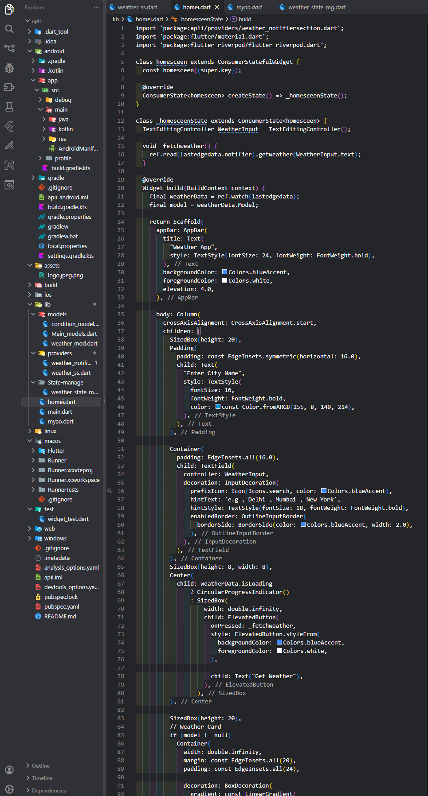
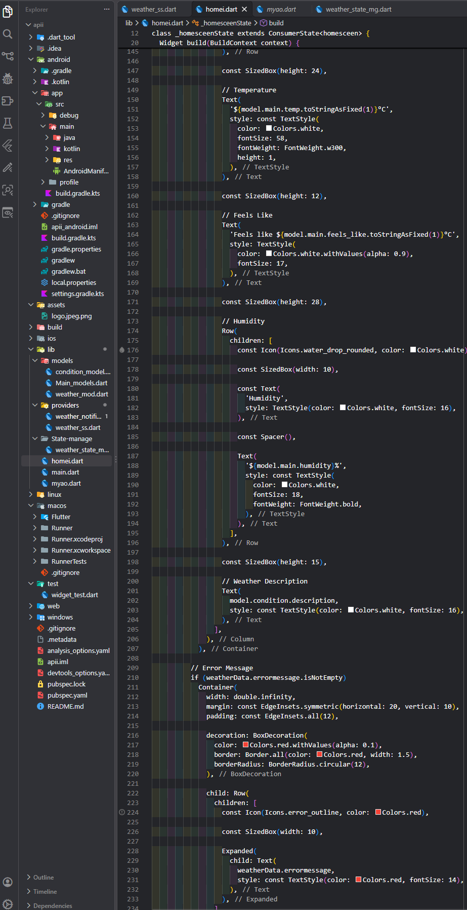
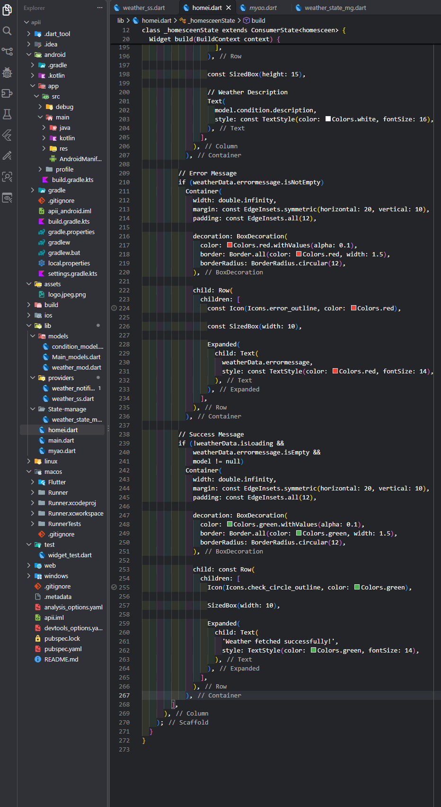
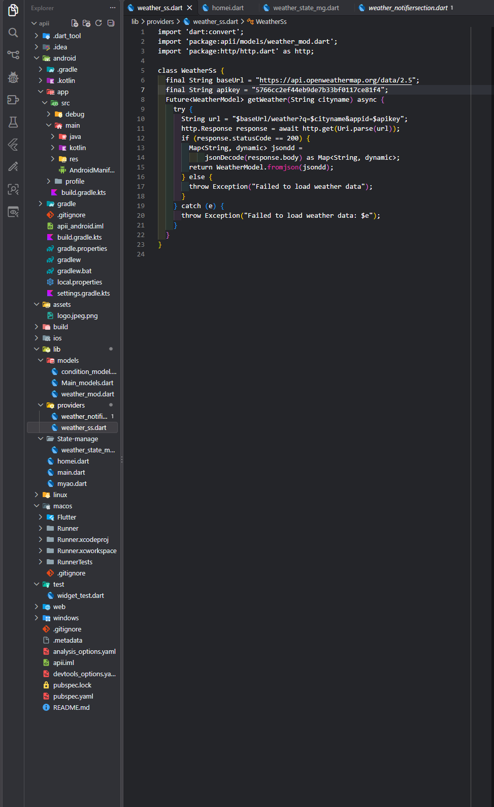
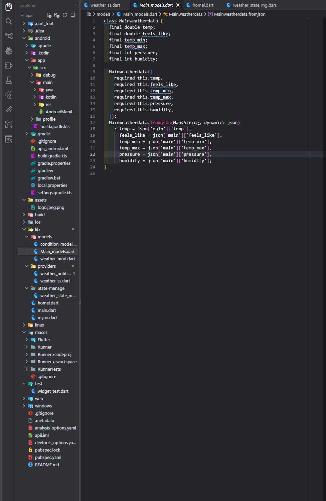
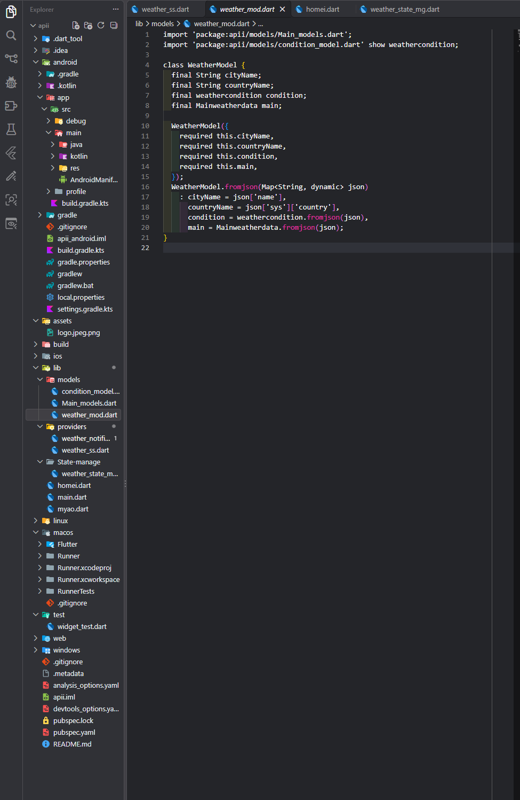
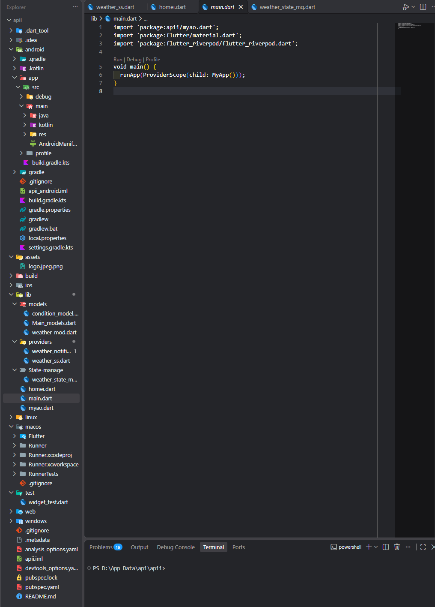
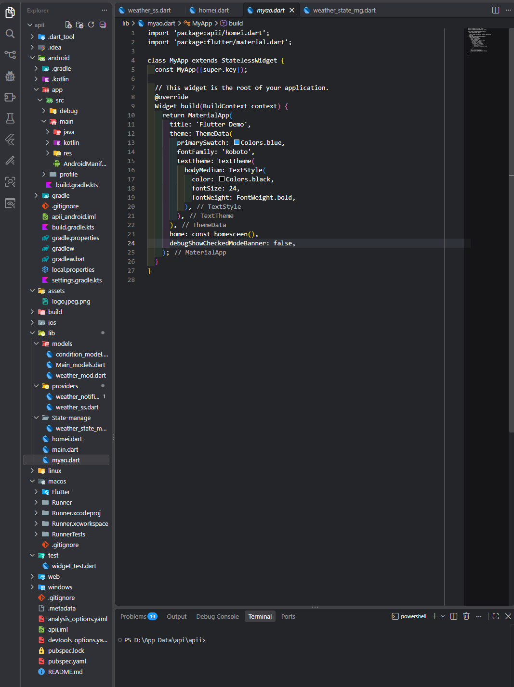

# weather-App-Api
# 🌦️ Weather App API

A modern Weather App built using Flutter that provides real-time weather information using a Weather API. Users can search for cities and view current temperature, weather conditions, humidity, wind speed, and other essential weather details.

## ✨ Features

- Real-time weather updates
- Search weather by city
- Temperature and weather conditions
- Humidity and wind speed information
- API integration
- JSON parsing and data modeling
- Loading states and error handling
- Clean and responsive UI

## 📸 Screenshots

### Home Screen

### Home Screen

### Home Screen

### Home Screen

### Weather Data Fetching

### Data modal

### json Format

### loading State

### main

### My app

### my Project

## 🛠️ Technologies Used

- Flutter
- Dart
- Weather API
- REST API
- JSON

## 🚀 Getting Started

1. Clone this repository.
2. Run `flutter pub get`.
3. Configure your Weather API key.
4. Run `flutter run`.

## 👨‍💻 Developer

Kunal Sirmour
